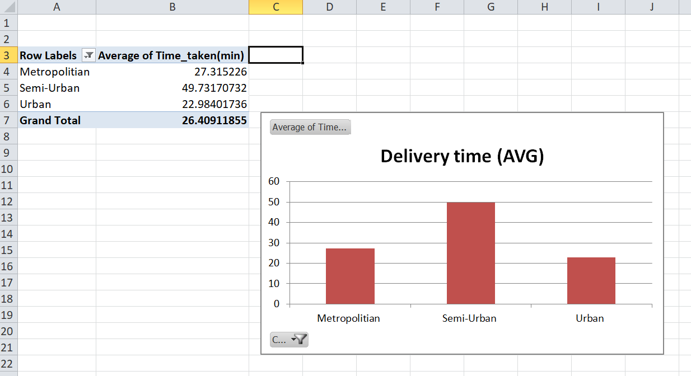
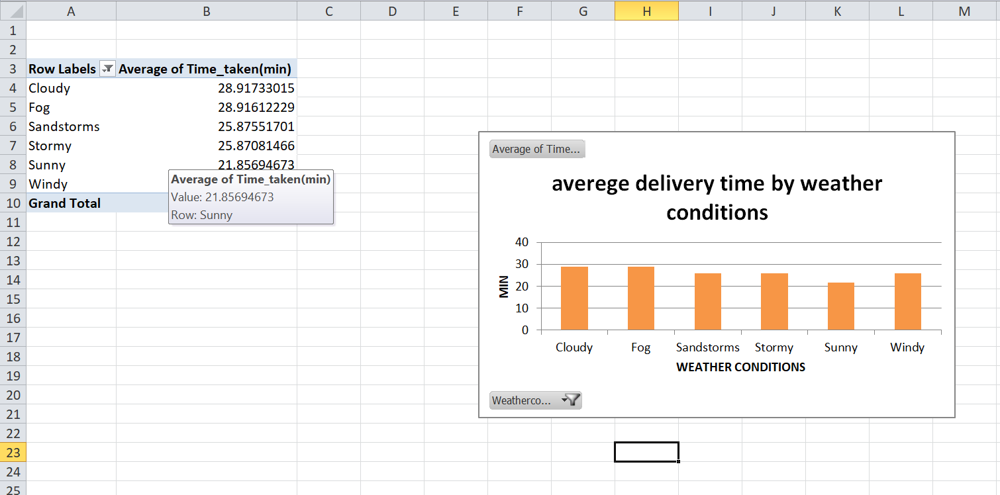
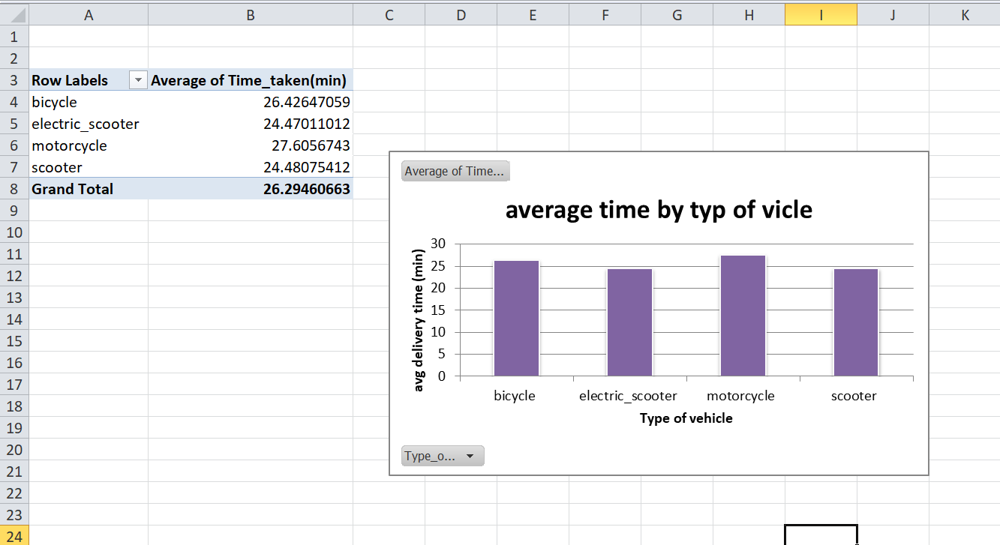

# Food Delivery Time Analysis (Excel)

## Objective
Find which factors affect food delivery time.

## Dataset
45,000+ food delivery orders from Indian cities (Kaggle link)(https://www.kaggle.com/datasets/gauravmalik26/food-delivery-dataset)
Columns include city, traffic density, weather, festival,
vehicle type and delivery partner rating.

## Tools
Microsoft Excel: Data Cleaning, Pivot Tables, PivotCharts

## Data Cleaning
- Removed text prefixes ("conditions ", "(min) ")
- Converted Time_taken to numeric
- Excluded NaN and invalid values (rating of 6) from analysis
  
## charts

## Key Findings (average delivery time)
1. Semi-Urban: 49.7 min vs Urban: 23.0 min (~2x slower)
2. Festival days: 45.5 min vs 26.0 min (~75% slower)
3. Traffic Jam: 31.2 min vs Low traffic: 21.3 min
4. Cloudy/Fog: ~28.9 min vs Sunny: 21.9 min
5. Vehicle type has a small effect (~3 min)
6. Partners rated 4.5+ deliver in ~24-25 min vs ~35 min
   for lower rated(correlation, not causation)

## Recommendation
Add more delivery partners on festival days and
in Semi-Urban areas.

## ## Skills Demonstrated
Data Cleaning, Pivot Tables, PivotCharts, Insight Writing
